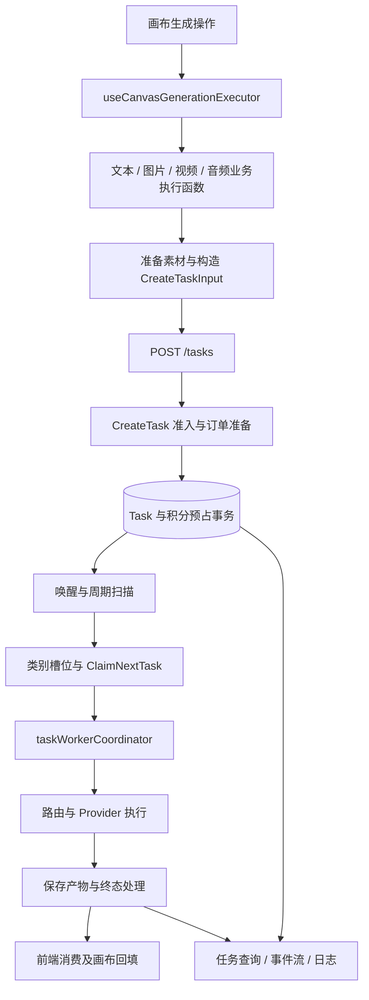
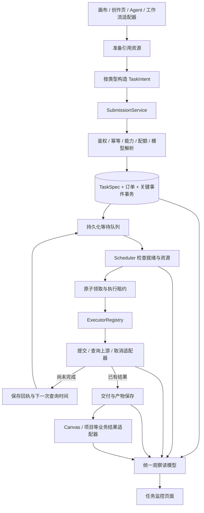

**画布任务公共模块重构分析与迁移建议**

分析对象为本地 `open-ai-canvas` 当前工作区，包含现有未提交修改。本文是提案，尚未实现新运行时或监控页面；依据源码、调用方和相邻测试进行静态分析，没有运行任务、压测或执行测试。文档中的新目录、字段和接口均为建议，不代表现有能力。

**结论**

采用“参数构造器 + 持久化队列 + 调度器 + 执行器 + 任务监控”的架构可行，也适合逐步迁移。需要调整的核心是：队列在执行器之前；持久化、准入校验和幂等提交在调度之前；生成后的交付与业务回填单独处理。

建议的主流程为：业务输入 → 准备引用资源 → 构造任务意图 → 服务端准入与解析 → 持久化任务及参数快照 → 等待队列 → 调度器领取 → 执行器调用 → 保存产物 → 业务回填。任务状态与事件从各阶段进入统一读模型，监控页面读取该模型。

本项目已经有这些能力的大部分基础。第一阶段应抽离边界、统一合同、连接实际入口，保留现有数据库、并发协调和账务能力。没有性能测量支持时，不应同时引入新消息中间件、重写供应商协议和重做计费。

**1. 当前实现与实际调用链**

| 环节 | 当前入口或实现 | 当前职责及判断 |
| --- | --- | --- |
| 画布生成入口 | `web/src/pages/canvas/use-canvas-generation-executor.ts:66` | 读取节点、配置和连接，解析上下文、准备引用，处理模型兼容性、提示词、技能、重复提交提示、节点状态和执行分派。职责较多。 |
| 分类型前端执行 | `canvas-image-generation-executor.ts`、`canvas-media-generation-executors.ts`、`canvas-text-generation-executor.ts` | 创建或复用结果节点、准备业务 metadata、提交后台任务、绑定任务与消费结果。这些“执行器”主要是前端业务编排，不是后台 Worker。 |
| 通用提交参数 | `web/src/services/api/generation-task.ts:293`、`:302`、`:438` | 已有 `prepareBackendGenerationTask`、`backendGenerationTaskInput`、`backendProviderConfig`。已有构造器雏形，但上传准备、模型选择、业务 metadata 与请求形状仍交织。 |
| 提交与等待 | `web/src/services/api/generation-task.ts:120`；`web/src/services/api/task-center.ts:138` | 已有只提交的 `submitBackendGenerationTask` 和提交后等待的 `runBackendGenerationTask`，底层 POST `/tasks`。可以直接作为公共提交门面的迁移起点。 |
| 浏览器批次待提交 | `web/src/pages/canvas/use-canvas-generation-batches.ts:176` | 批次保存在节点 metadata 中，Hook 每两秒推进 waiting 项，读取当前节点提示词与配置后调用生成入口。此阶段尚未等同于服务端 Task。 |
| 服务端任务创建 | `backend/internal/app/task_creation.go:59` | 输入标准化、制作规则、工具引用校验、模型目录解析、能力/额度/容量检查、加密、订单准备、创建 Task。仍明显依赖具体业务。 |
| 持久化入队 | `backend/internal/app/storage_quota.go:93`；`backend/internal/repository/finance.go:113` | 创建任务与积分预占在数据库事务内完成，提交成功后唤醒调度器并发布画布事件。排队本质上是数据库任务记录。 |
| 调度和 Worker | `backend/internal/app/task_worker.go:77` | API 进程内运行；按任务类别分 lane；先获取集群槽位，再领取任务并启动执行；本进程唤醒与两秒兜底扫描并存。 |
| 原子领取和恢复 | `backend/internal/repository/repository_tasks.go:63` | 按类别过滤后按创建时间领取 queued 或租约过期的 running，并检查 next_poll_at；PostgreSQL 使用 `FOR UPDATE SKIP LOCKED`，其他数据库使用条件更新保护。 |
| 租约和并发 | `backend/internal/platform/coordination.go`；`task_worker.go:170` | Redis/本地协调、类别槽位、渠道槽位、续租、租约失效保护已经存在。任务租约为 45 秒，执行时每 15 秒续租。 |
| 后端执行分派 | `backend/internal/app/task_execution.go:14`；`task_route_executor.go`；`provider.go:132` | Worker 中还有时间线、分批任务、媒体恢复等分支；路由执行器处理提交与失败切换；provider 入口继续处理输入、模板、模型、素材与协议分派。 |
| 结果交付 | `task_media_recovery.go`、`task_terminal.go`；前端 `generation-task-materializer.ts`、`canvas-generation-consumer.ts` | 已有生成后保存恢复、终态/账务处理、结果消费去重和画布持久化机制，应保留并重新划定边界。 |
| 展示和观察 | `web/src/pages/tasks/index.tsx`、`use-canvas-workspace-tasks.ts`、`backend/internal/app/task_execution_details.go` | 已有任务中心、画布任务面板、执行详情、日志、事件流和后台性能/策略页面；还缺统一的调度决策和运行资源视图。 |

当前普通画布生成的主要链路：



有两点容易被文件名或旧文档误导：

1. 当前画布批次调用 `generationBatchQueueCandidates`，它按无限候选槽位选择符合条件的 waiting 项；并非当前入口仍使用旁边的 `generationBatchCandidates` 按模型并发限流。真正执行并发由后端负责。批量提交仍有必要设置独立的网络背压，避免瞬时大量准备/提交请求。
2. `canvasGenerationUsesDurableQueue` 对普通画布图片、视频、音频以及 operation=text 的文本，将准入时 ActiveTaskLimit 置为 0；普通重试路径也有相应处理。这表示允许等待 Worker 槽位，并不代表执行并发无限，也不等于没有积分、存储或请求频率限制。新设计应明确区分排队容量与执行并发，不能直接照搬旧文档中的统一口径。

**2. 主要结构问题与优化优先级**

| 优先级 | 已观察到的情况 | 重构方向 |
| --- | --- | --- |
| P0 | 普通 `/tasks` 创建路径生成新 Task ID；本地 Map 锁与参数指纹负责点击防重，`clientOperationId` 主要在 metadata 中传递。该普通创建链路未见统一的用户范围幂等键唯一约束。Agent 等入口已有各自的幂等处理。 | 统一提交幂等合同：用户范围内同一键、同一规范化输入返回原回执；同一键、不同输入返回冲突。原子关联任务、订单及回执。参数相同但用户主动再次生成，应使用新键。 |
| P0 | 前端批次 waiting 项尚未成为服务端任务，推进依赖页面 Hook。已经提交成功的后端 Task 则可以继续执行。 | 把批次计划及依赖逐步迁到后端；未迁移前在 UI 明确标注“本地待提交”与“后台已接收”。不要把两者合成一个虚假的队列总数。 |
| P0 | 创建、调度、业务执行、路由恢复、账务与交付都连接到庞大的 app.Service。 | 新运行时通过小接口接入旧实现；抽离后仍保持原子入队、租约隔离、未知提交结果保护和交付恢复。 |
| P1 | 构造参数横跨画布 Hook、API 模块和服务端；执行时还会编译提示词模板、解析工具、样式及模型配置。 | 区分 TaskIntent、经服务端确认的 TaskSpec、每次调用的 ExecutionSpec。记录采用的版本与最终有效参数，明确哪些配置固定、哪些允许执行前重新校验。 |
| P1 | 已有类别队列，但领取主要按创建时间；主领取查询中未体现通用优先级、租户公平选择、通用依赖条件和等待原因。 | 先补可解释的调度结果，再按需求增加租户公平、优先级老化、依赖就绪与延迟领取。 |
| P1 | Worker 槽位先获取；渠道槽位在 HTTP 调用阶段等待；视频路径存在执行函数内轮询。 | 将“等待渠道”“等待上游”“实际执行”“媒体交付”分开。未来在等待时释放短期执行资源，但保留限制上游在途任务数量的独立约束。 |
| P1 | Task.Attempts 在每次 Claim 时递增，包括恢复/再次领取。 | 将 claimCount、executionAttempt、providerSubmitCount、pollCount、deliveryAttempt 分开，监控页不能把 attempts 直接标成供应商调用或扣费次数。 |
| P1 | 画布事件先于实时广播落库，但在任务写事务之后由单独调用生成；事件主要覆盖 canvas_* 且按画布订阅。 | 建立通用状态事件与版本；关键状态迁移和事件同事务写入，通知异步发送。已有快照查询继续作为断流或事件缺口后的恢复路径。 |
| P1 | 任务中心默认读取最近 30 条，再在前端过滤、统计、分页；当前默认 API 读取未接通真正的 nextCursor 分页。 | 新监控接口使用服务端过滤/分页与独立聚合；当前有限列表不能充当全系统队列统计。 |
| P2 | `internal/generation` 已有 Engine、Deps 和协议 registry；Engine 当前主要提供 registry 入口，未见生产组合根调用 NewEngine 承接执行主链。 | 避免再次增加仅存在类型和接口的平行架构。新模块必须有真实调用方、迁移对象和明确退场清单，并复用已有 protocol/generation 能力。 |

这里的 P0/P1 是重构顺序建议，不表示已通过运行测试确认发生了相应故障。普通请求提交幂等缺口、队列积压影响和渠道等待影响，都应在迁移时用故障注入或运行指标进一步验证。

**3. 建议调整后的职责与顺序**



“调度器 → 就绪执行队列 → Worker”也成立，但通常是后续拆分部署时需要的第二层队列。当前可以让调度器从数据库原子领取后直接交给执行器，无需先增加一份相同任务的 Redis 队列。执行器不负责产生自己将要执行的队列。

| 公共模块 | 负责 | 边界 |
| --- | --- | --- |
| TaskBuilderRegistry | 按任务种类选择构造器；规范化任务意图和类型参数 | 不读 React/Zustand；不发起供应商请求；不决定当前可执行数量。 |
| ResourcePreparer | 将浏览器文件、临时引用变成持久资源引用，报告准备进度 | 与纯构造器分开；纯构造结果可以重复计算。排队输入避免依赖将过期的临时签名 URL。 |
| SubmissionService | 鉴权、幂等、版本、模型/能力/额度检查、持久化回执 | 服务端是最终准入依据；前端校验仅用于交互。 |
| TaskQueue / TaskStore | 持久化候选任务、延迟时间和租约条件；提供原子领取 | 队列无需立即新增物理表。暂用现有 Task 表，经新适配器访问。 |
| Scheduler | 判断依赖、配额、类别、渠道、优先级和等待原因 | 不拼 prompt 或供应商 HTTP payload；不直接修改画布。 |
| ExecutorRegistry | 按类型查找执行实现，接受执行快照与上下文 | 逐步统一 Submit、Poll、Cancel 的结果合同；不重新领取任务，不负责所有业务页面状态。 |
| Lifecycle / Recovery | 状态转换、租约、取消、恢复与重试策略 | 区分“确定未发出”“已有上游 ID”“提交结果未知”“仅保存失败”。 |
| ResultDelivery | 保存产物、登记资源、幂等补偿交付 | 上游成功后保存失败不得重新调用模型。 |
| Observability | 聚合任务、等待原因、尝试、资源槽位和事件 | 页面读取经过授权和脱敏的 DTO，不直接读取私有参数或 Redis key。 |
| BusinessAdapter | 从节点/剧本/项目提取输入，以及把产物落回业务对象 | 节点位置、选中状态、分镜行、故事阶段留在业务层。 |

这里的“公共”是跨业务复用的领域能力，暂不意味着独立微服务，也不意味着所有能力放入一个 common 工具包。前端公共 SDK 与 Go 后端运行时通过版本化合同连接，不要求复用同一份可执行代码。

**4. 构造器应如何设计**

建议采用“按任务类型的构造函数 + 注册表”。只有出现需要多步组装的不变量时，再引入链式 Builder 类；不需要为了命名统一为每个任务写一个复杂 class。

构造器输入应已脱离画布结构，例如 `ImageTaskIntent`、`VideoTaskIntent`、`TextTaskIntent`；任务公共部分建议包括：

| 信息 | 建议字段 | 注意事项 |
| --- | --- | --- |
| 类型与版本 | schemaVersion、taskKind、operation、builderVersion | taskKind 表达能力；operation 表达具体业务操作；metadata 不应承载所有有行为含义的字段。 |
| 请求身份 | idempotencyKey、requestFingerprint | 前者区分一次操作，后者用于检测输入是否变化；不能用相同 prompt 代表同一次操作。 |
| 来源 | source、canvasId、nodeId、projectId、workflowRunId、parentTaskId | 用户身份从登录上下文读取；字段出现也必须检查资源归属。 |
| 内容 | prompt、references、按 taskKind 区分的 params | 避免所有字段 optional 的大对象；text/image/video/audio 分别定义参数结构。 |
| 选择 | modelSelection、capabilityRequirements | 前端表达需求；实际渠道、价格和密钥由服务端确认。 |
| 依赖与调度请求 | dependsOn、priority、notBefore、deadline | 这些是用户意图或内部提示，服务端按权限和策略决定有效值。 |
| 结果目标 | outputBinding | 说明结果绑定位置，不携带 setNodes、组件回调等进程内对象。 |

TaskIntent 是提交意图；TaskSpec 是服务端准入后固定的规范任务；ExecutionSpec 是某个执行尝试实际采用的模型、协议、模板、资源版本与有效参数。三者应能关联，但用途不同。

批次和有依赖的工作流还需要 TaskPlan：接收时持久化用户意图、依赖关系和配置版本，前置产物出现后再构造具体子任务的最终输入，并记录引用了哪个产物版本。不能为了“一次构造完”提前读取不存在的结果，也不能等到执行时重新读取用户已经修改的画布输入。Task、执行 attempt 与上游请求也要分别有身份；同一个 Task 的领取、轮询和交付恢复不应自动视为新的付费生成。

不能只依靠前端构造器冻结参数：重试、Agent 和后台工作流也会创建任务。服务端应保留权威解析。对于一次新执行，记录模板/模型版本和有效参数；若重试因渠道配置修正需要重新解析，创建新的 attempt 快照并保留历史依据，不悄悄覆盖上一轮记录。密钥只保存受保护的引用或沿用已有加密方案，公开快照必须脱敏。

**5. 状态、恢复与并发口径**

不建议第一步直接改掉现有五个公开状态。先为旧任务建立派生读模型，再引入内部结构化 phase 与 waitingReason；`stage` 保留给用户文案，不用中文字符串驱动调度。

| 概念 | 示例 | 展示与调度意义 |
| --- | --- | --- |
| 生命周期 status | queued / running / succeeded / failed / cancelled | 用于总体筛选；迁移初期兼容现有读写。 |
| 执行 phase | preparation / dependency_wait / provider_submit / provider_wait / delivery / binding | 表示当前处于哪里；不把所有 running 都解释为正占用 CPU 或正发请求。 |
| 等待原因 waitingReason | dependency / worker_capacity / channel_capacity / retry_backoff / manual_review | 解释为什么还没往下走，以及系统是否会自动继续。 |
| 提交结果 submissionOutcome | not_sent / accepted / unknown | 决定能否安全重发；不得仅因超时就创建第二个供应商任务。 |
| 结果交付 resultState | pending / saving / ready / failed_retryable | 结合现有 mediaStage/resultState；不把生成成功和回填成功混成一种成功。 |

建议把一次执行返回值收敛为 Completed、Pending、RetryableFailure、PermanentFailure、SubmissionUnknown 等互斥结果，而不是依赖异常文案猜下一步。Pending 必须带已持久化的上游回执及建议查询时间。

并发至少分四种口径：接收/排队容量、短期执行槽位、供应商在途任务数量、上传下载与交付槽位。当前 image/text/agent/video/audio/other 分类及渠道分类限额应继续复用。后续若把远端轮询等待改为释放 Worker，必须另保留供应商在途限额，否则会改变当前限制效果并瞬间提交更多远端任务。

取消是持久化命令，不等于停止前端等待。暂停批次应明确为“暂停新增调度”，与“请求取消已开始任务”分开。上游取消未确认、费用待核对与真正已取消需要可区分展示。

通用运行时不应要求父任务一直占用生成槽位等待子任务。现有短剧分批父任务已经采用重建状态、推进一轮、延迟再次领取的方式；迁移时应保留这个特性。Agent 根任务的控制面载体与实际模型调用任务也应继续区分，不能统一后把根任务当成额外的付费模型调用。

依赖图需要循环检查、父子取消传播和共享依赖语义。独占子任务可随父任务取消；被多个流程共享的事实提取任务不能因一个消费者取消而被错误终止。

**6. 任务监控页的信息与数据合同**

页面目标是让用户回答“任务是否被接收、为什么等待、现在由什么执行、是否会自动继续、是否需要处理”。沿用现有工作区外壳、任务列表、详情抽屉与设计 token；本轮只明确功能和数据需求，不制作视觉稿。

建议新增任务监控路由及页面目录，通过现有任务中心导航进入。复用一套底层观察数据：普通用户只看有权访问的任务，管理员增加全局队列、Worker 和渠道资源视图，权限在服务端执行。

| 页面区域 | 建议展示 |
| --- | --- |
| 概览 | 后台已接收等待、执行中、等待上游、交付中、需要处理；显示统计范围和更新时间。 |
| 分类资源 | 文本/图片/视频/音频/Agent 队列长度，执行占用/上限；管理员可展开渠道占用与调度暂停原因。 |
| 任务表 | 名称、来源画布/节点、类型、有效模型、当前阶段、等待原因、等待时长、执行时长、下一次尝试时间、结果状态。 |
| 任务详情 | 构造意图和脱敏有效参数、调度决策、执行尝试、上游回执、事件时间线、产物与回填记录。 |
| 批次/流程详情 | 父子任务、前置依赖、各项等待原因、完成/失败/未启动数量；支持定位画布节点。 |
| 操作 | 取消待执行、请求停止、重试、仅重试保存；批次暂停新增调度/继续。操作是否可用由后端返回 allowedActions。 |

不建议显示没有依据的精确排队名次或完成倒计时；优先级、公平调度和依赖条件会改变顺序。可显示等待时长、阻塞原因与有依据的区间估算。无供应商百分比时展示阶段，不能伪造持续增长的进度条。

建议新增查询能力，而不是把整个 Task 私有模型暴露给页面：

| 查询或命令 | 建议作用 |
| --- | --- |
| 任务列表查询 | 服务端按状态、阶段、项目、类型、时间过滤，返回游标和下一页。 |
| 范围聚合查询 | 独立统计当前可见任务队列，不从已加载页面列表计算全局数量。 |
| 任务运行详情 | 返回 attempt、等待原因、下一次领取时间、交付信息与 allowedActions。 |
| 事件增量订阅 | 按用户/项目/管理员范围鉴权，支持游标重连；事件超保留期时重新取快照。 |
| 管理员运行资源查询 | 活跃 Worker、心跳、类别/渠道占用、排空状态和错误摘要。 |
| 生命周期命令 | 校验任务版本及当前状态，执行取消、暂停、继续、重试或重试交付。 |

先复用现有 `/tasks`、`/tasks/:id/execution`、日志和画布事件适配出监控读模型。旧运行时暂时无法提供的 waitingReason，应明确为“暂无调度原因”，不能靠 queued/running 随意推断。需要更准确的原因时，由调度器记录决策代码和策略版本。

观察页应保持只读观察与显式命令分开。现有任务中心 loadTasks 会触发完成结果的画布同步；新监控页面不复制这个隐式写操作，把消费/回填交给独立业务适配器。

**7. 新目录及依赖方向建议**

以下是建议结构，按迁移阶段逐步创建，不要求先生成全部空文件：

```text
web/src/
  lib/task-runtime/
    contracts.ts
    builders/
      registry.ts
      text-task-builder.ts
      image-task-builder.ts
      video-task-builder.ts
      audio-task-builder.ts
  services/task-runtime/
    resource-preparer.ts
    submission-client.ts
    observation-client.ts
    legacy-task-adapter.ts
  pages/canvas/task-adapters/
    canvas-input-adapter.ts
    canvas-result-adapter.ts
  pages/task-monitor/
    index.tsx
    components/
    hooks/

backend/internal/
  taskruntime/
    contract/
    builder/
    submission/
    queue/
    scheduler/
    executor/
    lifecycle/
    observation/
  app/
    taskruntime_wiring.go
    taskruntime_legacy_executor.go
  repository/
    taskruntime_store.go
  handler/
    task_monitor_routes.go
```

contract 放独立值对象、状态、请求/回执合同。queue 放持久队列端口与语义，GORM 实现在 repository 新文件。scheduler 依赖队列/资源/时钟端口，executor 通过 registry 接入具体实现。原 platform、protocol、generation、资源及账务能力由 app 组合根装配。

新 taskruntime 域不能反向 import app 或 service。旧执行器包装放在 app 中，实现新 executor 定义的接口后注入。这样新模块不需要认识旧 Service，旧业务又能被渐进复用。

这里的 task builder 构造业务任务及规范执行需求；已有 protocol adapter 继续构造供应商 HTTP 请求。不要让新的 builder 注册表复制一套供应商协议注册表。前后端共享字段应有单一的版本化 schema 或契约校验来源，可沿用仓库已有的合同/生成方式，避免两端各维护一份随意扩张的参数枚举。

前端纯构造器只接收稳定 DTO，不接收 CanvasNodeData、store 或 setNodes；画布适配器负责把节点解析成 DTO。网络和上传副作用留在 services，页面层保留展示与交互。

新公共逻辑可以全部写在新文件中，但旧入口、路由和组合根必须有少量接线修改，否则新模块不会被调用。过渡适配器要注明服务的入口和删除条件，不能长期保留两套参数、状态与执行策略。

**8. 推荐迁移顺序及完成条件**

| 阶段 | 实施内容 | 可审查的完成标准 |
| --- | --- | --- |
| 0：冻结合同与基线 | 确认任务种类、状态、调用身份、旧 Task/订单/回执语义；建立现有任务到统一观察模型的映射。 | 能画出真实调用链；所有旧任务类型都有去向；监控指标注明范围与缺失字段。 |
| 1：公共构造与单任务试点 | 将资源准备与纯参数构造拆开；先接一个普通图片单任务入口，仍通过现有创建与 Worker 链执行。 | 新旧构造可在不发请求的情况下比较；输入输出、引用顺序、模型选择一致；没有重复真实提交。 |
| 2：可靠提交与监控初版 | 后端公共提交门面、用户范围幂等回执、规范快照；新监控页接真实旧运行时数据。 | HTTP 回执丢失后用相同键重试只产生一个任务和一次预占；页面能区分未提交、已排队、执行与保存。 |
| 3：抽离执行生命周期 | 用 registry 包装旧 provider；逐步抽出状态迁移、租约、路由恢复、取消和交付。 | 旧协议照常运行；续租失败的旧执行者不能写终态或触发重复账务；保存失败仅恢复保存。 |
| 4：后端批次与调度器接管 | 将浏览器待提交批次变成持久计划；抽离调度策略与队列适配器；补等待原因与公平/背压。 | 接收计划后关闭页面仍能推进；重启恢复；依赖顺序正确；每个任务仅归属一个领取路径。 |
| 5：其余入口迁移与退场 | 迁移视频、音频、文本、工作流和 Agent 等，最后评估独立 Worker 进程。 | 调用方不再绕过公共门面；删除已无调用的旧构造/调度代码；保留旧数据解码与必要迁移适配。 |

单任务试点选择已有规范输入、较少前后置业务的图片入口。已有 `canvasGenerationUsesDurableQueue` 可直接复用。视频的异步回执、文本的流式回放以及 Agent 的审批/预算逻辑各有复杂性，适合在核心合同验证后迁移。

每个阶段既做新模块，也接通一条真实路径。不要用“创建了目录和接口”作为阶段完成标准。监控数据适配从阶段 0 开始，真实页面在阶段 2 交付，不必等所有业务迁完。

迁移期优先保留一个现有 dispatcher，只将其执行交给新 registry。若必须让新旧调度器并存，需要在任务落库时固定 runtimeVersion/执行归属，旧 Claim 与新 Claim 使用互斥条件，且共享同一套全局容量口径。仅靠前端 feature flag 无法隔离两个后端领取者。变更协调 key 或容量语义时先排空在途执行，不能把两个独立槽位池的上限相加。

回退按新任务入口切换；已开始任务继续由其已固定的版本完成或进入受控恢复。保留现有 Task ID、供应商回执、订单关系和结果身份；不通过重新创建历史任务实现回退。回退版本也必须能识别已落库的新 schema，不能只回退代码后放弃待执行任务。

**9. 迁移验收重点**

| 场景 | 预期 |
| --- | --- |
| 提交成功但 HTTP 回执丢失 | 重发相同操作键返回原任务，不重复预占；不同参数复用键明确冲突。 |
| 关闭或刷新画布 | 已接收任务继续；后端批次计划继续；恢复页面不会重复应用结果。尚未上传完成的本地文件准备明确保持本地状态。 |
| Worker 超时、重启、租约被接管 | 保留可查询的上游任务；旧 worker 被隔离，不能覆盖新 worker 或重复结算。 |
| 上游提交结果未知 | 标记需回查/核对；具备供应商幂等或恢复证据才重发，不盲目切备用路由。 |
| 上游成功但下载/上传/素材登记失败 | 只恢复交付，保留供应商结果及计费身份。 |
| 降低并发配置 | 不强行取消在途任务，停止补位到占用回落；队列与在途指标口径一致。 |
| 父任务等待子任务 | 不长期占用子任务需要的执行槽位；共享子任务不被单个父任务错误取消。 |
| 取消与完成并发发生 | 状态条件更新、取消意图与费用处理保持一致，不能显示取消但继续覆盖新业务结果。 |
| 事件断线、乱序或过期 | 依据任务版本/事件游标合并，缺口用快照恢复；不会由旧事件回滚状态。 |
| 大量等待任务与多用户 | 有界提交、服务端分页、聚合准确；能观察最老等待和各用户获得服务的情况。 |
| 新旧系统切换 | 一项任务只由一个运行时领取；同一结果只消费一次；不改变已确认的账务语义。 |

现有 `task_worker_test.go`、`task_lease_fencing_test.go`、`task_route_executor_test.go`、`task_retry_billing_test.go`、`task_media_recovery_test.go`、`canvas-generation-submission.test.ts` 与 `generation-task-durability.node.test.ts` 可以作为回归素材。本文只检查了相关代码和部分测试内容，未运行它们；未来执行器或数据库领取变更还需要在 PostgreSQL + Redis 环境验证跨进程行为，不能仅凭 SQLite 单测判断集群正确。

**建议的首个实施批次**

交付 task 合同、普通图片构造器、公共提交门面及旧运行时观察适配器，接通一条真实图片生成路径；同时明确提交幂等设计及现有任务列表的分页/统计合同。随后加入可靠提交和监控初版，再推进调度器与批次后移。这样每一批都有可以验收的行为，也能尽早发现抽象是否贴合当前业务。
