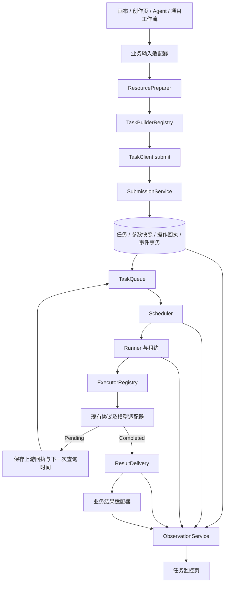

**公共任务运行时完整实施规格**

状态：待实施。本文确定目标设计、接口、存储、页面和迁移约束；不表示对应代码已经存在。与 `docs/design/task-runtime-reconstruction-analysis.md` 配套，具体执行顺序见 `docs/plans/task-runtime-implementation-runbook.md`。

依据：当前工作区源码，包含现有未提交修改。实现前按执行手册核对变化。所有示例字段、路由和目录为拟新增设计；现有文件与能力另行标注。

**1. 目标与实施范围**

目标是将每次任务提交统一为“准备资源 → 类型构造器 → 服务端受理 → 持久化队列 → 调度 → 执行 → 结果交付 → 业务回填”，并能在一个页面观察任务从接收到完成的全过程。

完成后的约束：

- 构造器、提交、队列、调度、执行生命周期和观察均有独立公共模块与真实调用方。
- 画布、创作页、项目工作流与 Agent 使用同一任务基础设施，保留各自的授权、审批和业务回填规则。
- 已接收任务不依赖浏览器存活；已接收的服务端批次计划也不依赖画布页面。
- 同一操作重发不会创建第二个任务或第二次积分预占；用户主动再次生成使用新的操作身份。
- 生成失败、提交结果未知、保存失败与回填失败可分别判断和处理。
- 已有 Task ID、订单、供应商回执和历史结果在迁移中保留。
- 每个阶段都接通可运行路径；不先搭建无人使用的公共框架。

第一轮采用模块化单体：Go API 进程继续承载 Worker，数据库继续保存任务，现有 platform 协调器继续负责共享资源协调。独立 Worker 进程是验收核心架构后的可选部署步骤。首轮不更换供应商协议体系，不重建账本，不引入第二份 Redis 任务消息队列。

**2. 固定架构与模块边界**



| 模块 | 输入 / 输出 | 必须保持的边界 |
| --- | --- | --- |
| BusinessAdapter | 业务对象 → 稳定 DTO；结果 → 业务写入 | 节点、分镜行、故事阶段、选中状态留在这里。 |
| ResourcePreparer | 临时文件/引用 → 可持久解析的 ResourceRef | 可异步、有副作用；支持取消和有界并发。 |
| BuilderRegistry | 类型 DTO → TaskIntent | 纯函数，不访问数据库、React、Zustand、网络、当前时间或随机数。操作 ID 由调用层传入。 |
| SubmissionService | TaskIntent + Actor + 操作键 → Receipt | 权威校验、解析、快照、幂等、额度/账务、事务受理。 |
| TaskQueue | 查询条件 → 原子领取结果 | 保存任务事实和租约，不决定业务 prompt，不直接执行任务。 |
| Scheduler | 候选任务 + 策略 + 资源 → DispatchDecision | 依赖、优先级、公平性、等待原因、资源许可。 |
| Runner | 已领取任务 + Executor → 生命周期迁移 | 续租、取消、超时、提交检查点、结果分类与持久化。 |
| ExecutorRegistry | TaskKind + ExecutorVersion → Executor | 不拥有领取循环；不自行创建账单或回填画布。 |
| Lifecycle | 状态 + 命令/执行结果 → 原子迁移 | 所有 v2 任务状态变更的唯一入口。 |
| ResultDelivery | 已生成输出 → 持久产物与交付回执 | 下载/保存/登记失败仅恢复交付。 |
| PlanCoordinator | 持久计划 + 前置产物 → 子任务 | 编排批次与依赖，不占用模型执行槽位等待子任务。 |
| ObservationService | 查询范围 → 授权、脱敏的读模型 | 不隐式消费结果；页面查看本身不修改画布。 |

依赖方向：HTTP → handler → service 别名 → app 组合根 → taskruntime 域及端口 → repository/platform/protocol 适配器。taskruntime 禁止 import app/service。旧实现的桥接代码放在 app，再由组合根注入新接口。

**3. 合同、身份与版本**

将四种对象明确区分：

| 对象 | 何时创建 | 语义 |
| --- | --- | --- |
| TaskIntent | 用户提交或后台业务发起时 | 创作意图、用户选项、资源引用和结果目标。 |
| TaskSpec | 服务端受理时 | 经授权、规范化和目录校验的不可变任务快照。 |
| ExecutionSpec | 一个供应商尝试进入提交前 | 该尝试实际采用的 prompt、资源版本、模型/协议/路由及有效参数。 |
| TaskPlan | 批次或工作流被接收时 | 固定的任务模板、依赖关系、预算授权与输出引用规则。 |

任务身份沿用现有 Task.ID；用户主动重新生成沿用现有 RouteRun 世代；渠道尝试沿用 RouteAttempt.ID 和 AttemptNumber。轮询、Worker 重新领取、保存恢复均不得自动增加 RouteRun 或创建新计费请求。暂不建立与 RouteAttempt 语义重叠的另一套 attempts 表。

版本独立记录：schemaVersion 表示合同格式；builderVersion 表示业务参数解释；specRevision 表示任务规范快照修订；runtimeVersion 表示生命周期处理方式；executorVersion 表示处理实现；stateVersion 表示状态并发版本。它们不能互相替代。

本次约定 schemaVersion=1；runtimeVersion=0 表示旧执行生命周期，允许已经通过新提交接口生成 Spec/Command；runtimeVersion=2 表示新 Runner/Lifecycle。受理时固定 runtime/executor 版本。观察 DTO 用 eventCoverage=legacy_snapshot/admission_only/full 区分保障范围：R2 只保证受理事件原子落库，R4 对完成生命周期迁移的任务才标记 full。

TaskSpec 修订只追加、不原地覆盖。普通失败重试复用原 Spec，显式增加 RouteRun 并重新检查授权/账务；修改 prompt、资源或生成选项默认形成新的操作与 Task。确需在原 Task 下更换规范时，必须用独立的版本化命令，同时创建新 Spec 修订和执行世代，禁止更改在途尝试引用的 Spec。

跨端类型沿用仓库已有 Go 合同导出方式：以 `backend/internal/taskruntime/contract` 中的公共 wire 类型及枚举为源，`go:generate` 输出 TypeScript 类型和合同样例。保留现有 `http` API 客户端，不从 OpenAPI 生成客户端。先复用/映射 `internal/canvas/contract` 中的模型选择与资源角色；不在新模块重复定义不一致的枚举。语义验证通过两端同一组有效/无效样例校验。

以下为接口形状，完整字段由该生成源定义：

```ts
type TaskKind = "text" | "image" | "video" | "audio"
  | "timeline_transcription" | "timeline_render";

type TaskIntent<K extends TaskKind> = {
  schemaVersion: 1;
  kind: K;
  operation: string; // 服务端按 kind 和调用者权限校验白名单
  source: TaskSource;
  prompt?: string;
  modelSelection?: ModelSelection;
  references: ResourceRef[];
  params: TaskParams[K];
  outputBinding?: OutputBinding;
  schedule?: { notBefore?: string; deadline?: string; priority?: number };
};

type SubmitTaskRequest<K extends TaskKind> = {
  idempotencyKey: string;
  intent: TaskIntent<K>;
};

type TaskReceipt = {
  taskId: string;
  commandId: string;
  specRevision: number;
  acceptedAt: string;
  replayed: boolean;
};

interface TaskBuilder<K extends TaskKind> {
  readonly kind: K;
  readonly version: string;
  build(input: BuildInput[K]): TaskIntent<K>;
}

interface TaskClient {
  submit<K extends TaskKind>(request: SubmitTaskRequest<K>): Promise<TaskReceipt>;
  get(id: string, signal?: AbortSignal): Promise<TaskView>;
  observe(scope: TaskScope, listener: (event: TaskEvent) => void): () => void;
  command(id: string, command: TaskCommand): Promise<TaskCommandReceipt>;
}
```

实际 wire 解码必须验证 kind/params 的对应关系；Go 不能仅用 `map[string]any` 传到底。按 kind 解码到具体参数类型，拒绝影响执行的未知字段，并返回字段路径错误。text/image/video/audio 参数分别定义，具体有效值仍由模型能力目录决定，不在公共枚举中硬编码全部供应商参数。

ResourceRef 使用 resourceId、版本/内容身份、媒体类型、role 与 order。执行时解析有时效的访问 URL，不把短期签名 URL 当作长期身份。参考图、首尾帧、mask 的顺序和角色必须进入参数快照及请求哈希。

source/outputBinding 是可校验的定位信息，不是授权证明。actor 来自会话；Agent 审批、预算、CreationSubmission 等通过内部授权上下文传入，公共请求不能提供 NonBillable、任意用户、任意批准标记或自定 Task ID。

普通 v2 试点先支持系统逻辑模型与系统渠道。自定义渠道在入口迁移阶段通过专门的敏感提交适配器接入：凭据与 TaskIntent 分开传输，沿用后端保护/加密机制，ExecutionSpec 只保存受保护的凭据引用；重试校验使用服务端生成的凭据上下文摘要，不能因忽略凭据变化而错误复用操作键。浏览器 pending draft、事件和公开参数快照均不保存明文密钥。

**4. 构造器的实现步骤**

前端处理顺序固定为：读取业务输入快照 → 创建并持久保存操作 ID → 校验与准备引用 → 纯构造器生成 Intent → 提交 → 保存回执/绑定 taskId → 订阅状态。页面更新只在适配器中完成。

| 构造器 | 迁移来源 | 输出重点 |
| --- | --- | --- |
| ImageTaskBuilder | `canvas-image-generation-executor.ts`、`generation-task.ts` | prompt、图片角色与顺序、尺寸/质量、目标节点及版本。 |
| VideoTaskBuilder | `canvas-media-generation-executors.ts` | 文生/图生/编辑 operation、首尾帧、视频/音频引用、时长及输出目标。 |
| AudioTaskBuilder | 同上与音频配置 helpers | 配音/音效类型、音色/参考音频、速度格式与声明式扩展选项。 |
| TextTaskBuilder | `canvas-text-generation-executor.ts`、短剧工作流 | 文本历史、结构化输出合同、流式选项、来源材料版本。 |
| Timeline builders | `timeline-tasks.ts` 与后端时间线入口 | 转写源、时间线修订、渲染参数；不借用模型计费语义。 |

业务适配器负责将风格、技能、分镜引用等业务规则解析成明确的构造输入。公共构造器不读“当前选中节点”或“当前配置”；构造结果也不含 AbortController、函数和组件对象。

TypeScript builder 负责页面输入到 Intent，Go builder 负责权威规范化到 TaskSpec，以及计划/后台调用的类型化输入；不尝试在两个语言中共享可执行代码。两端共享 wire 合同和样例，最终权限、价格、模型能力和有效参数始终由 Go 端校验。供应商请求 payload 在 ExecutionSpec/协议适配层构造，不能让页面 builder 绑定某家供应商协议。

多张图片默认将用户的样本数量转成批次计划，每个独立调用有子项键。已有供应商单次返回多输出的入口保留原适配语义，产物通过 outputIndex 区分；不能为了统一构造器悄悄改变调用次数或计价。

依赖尚未产生的内容保存为 PlanNode 模板。等依赖 ready 后，服务端将具体产物版本绑定到模板，构造并受理子 Task；不重新读取后来被用户修改的画布输入。

**5. 统一提交与幂等事务**

普通新接口为 `POST /api/task-runtime/tasks`。旧 `/tasks` 在迁移期继续存在，内部逐步进入同一准备/受理能力。复用 `CreateTask` 内的权威校验、目录解析、报价、容量检查和保护逻辑，但拆成不落库的 Prepare 与可参加同一事务的 Commit；禁止先调用旧 CreateTask 落库，再补幂等回执。

受理算法：

1. 读取 Actor，验证请求形状，规范化输入并计算 canonicalRequestHash。该哈希使用提交意图，不依赖会变化的当前目录、当前时间或随机字段。
2. 用 `(userId, namespace, idempotencyKey)` 查已有命令回执。找到后先检查访问权限；同哈希返回原回执，不重新报价、不重新执行当前目录校验；不同哈希返回 `idempotency_conflict`。
3. 未命中时准备 TaskSpec、模型目录/资源版本、账务和配额检查结果。网络/大文件准备不得占用数据库事务；最终可用性、价格授权与容量在事务内必要复核。
4. 在单个数据库事务中争取唯一操作键，复核结果，创建 Task、TaskSpec、需要的订单及积分预占，保存命令回执、初始状态事件。并发唯一键冲突者重新读取已提交回执；不得吞掉未完成/回滚事务的差异。
5. 事务提交后唤醒原 dispatcher 和事件通知。通知丢失时由数据库扫描恢复，不影响任务已受理事实。
6. 返回 TaskReceipt。前端立即结束“提交中”，后续观察独立于页面 mutation。

重复提交与新的用户操作必须区别：HTTP 重试沿用同一 key 和冻结的请求；用户点击“再次生成”使用新 key；普通重试命令使用独立 command key 并显式指定原任务/状态版本。

前端 SDK 保存用户隔离的 pending submission：操作键、冻结的非敏感请求、指纹、状态和回执。回执丢失后先查该键，或以原键重发；不得重新生成 key。资源准备阶段尚未成为服务端任务，UI 明确标注“本地准备中”。

请求规范化必须明确：是否去掉首尾空格、缺省和显式值是否等价、参考资源数组顺序、数字与字符串类型。服务端计算哈希并作为权威，两端合同样例覆盖语义一致性。报价批准的重放不能因当前价格变化触发另一笔预占；真正重新生成必须创建新的执行世代并重新经过现有批准/账务判断。

**6. 数据结构及分批迁移**

继续使用现有 tasks 作为任务身份与生命周期事实源。新增字段用新文件定义 `TaskRuntimeFields`，在原 Task struct 中嵌入；RouteAttempt 采用同样方式添加扩展字段。这属于必要的少量旧文件接线修改。

| tasks 新字段组 | 建议字段 | 说明 |
| --- | --- | --- |
| 运行身份 | runtime_version、executor_version、spec_revision | 历史任务 runtime_version=0；新任务固定处理版本。 |
| 并发与状态 | queue_kind、state_version、lease_epoch | 分类字段替代长期依赖 CASE 推导；每次新租约递增 epoch。 |
| 运行阶段 | phase、schedule_state、waiting_reason、waiting_details_json | schedule_state 为 eligible/blocked/paused/terminal；不是第二套 task status。 |
| 调度 | priority、deadline_at、plan_id、plan_node_key | `notBefore`、轮询和退避的下一次可领取时间复用 NextPollAt，不再新增重复的 ready_at。 |
| 观察时间 | phase_started_at、last_progress_at | 不用续租更新的 UpdatedAt 推算真实进展。 |

LeaseOwner、LeaseExpiresAt、ProviderRequestID、MediaRecoveryJSON、RouteRun、BillingOrderID 继续保留原身份。状态恢复不能清空已存在的供应商回执再调用提交接口。

| 新表 | 创建阶段 | 主键/唯一性与用途 |
| --- | --- | --- |
| task_specs | R2 | `(task_id, revision)` 唯一；保存受保护的 Intent/Spec、哈希、构造器版本、模型/模板/资源引用版本。只追加修订。 |
| task_commands | R2 | `(user_id, namespace, idempotency_key)` 唯一；请求哈希、目标任务/计划、规范回执。创建、重试、取消等命令共用，但 namespace 区分。 |
| task_runtime_events | R2 | `(user_id, seq)` 唯一；taskId、routeRun、stateVersion、eventType、脱敏 payload。作为持久事件日志。 |
| task_event_streams | R2 | user_id 主键；已提交高水位与最小保留游标。串行分配同一用户事件序号。 |
| task_effects | R4 | effect_key 唯一；保存/登记/结算/退款/绑定等持久副作用任务，含状态、版本、租约和 next_attempt_at。 |
| task_scheduler_scopes | R5 | scope_key 主键；类别公平轮转游标；后续也用于在途容量检查的数据库锁定范围。 |
| task_plans | R6 | planId；userId、状态/版本、模板版本、失败策略、已批准预算授权引用。 |
| task_plan_nodes | R6 | `(plan_id, node_key)` 唯一；冻结模板、状态、解析后的输入身份、taskId、重试世代。 |
| task_plan_edges | R6 | `(plan_id, from_key, to_key)` 唯一；依赖输出槽与依赖类型。 |
| task_provider_reservations | R7 | `(route_attempt_id, scope_key)` 唯一；远端在途许可，区分 submitting/accepted/uncertain/released，关联供应商回执。 |

RouteAttempt 扩展保存 ExecutionSpecJSON/Hash、specRevision、submittedAt、lastPolledAt、pollCount，以及明确的能力声明版本。不另外复制请求和收费事实。现有 attempts 继续代表领取次数，读模型另显示 routeRun、routeAttemptCount、已证实 providerSubmitCount、pollCount、deliveryAttemptCount；历史无法确定的值返回 null。

TaskEffects 用稳定键，例如 `(taskId, routeRun, outputIndex, effectType, targetIdentity)`。不同账务动作并不因 effectKey 不同就都能执行：执行前仍由现有订单状态条件判断 settle/refund/uncertain 的互斥关系，任务世代和决策版本也必须匹配。

数据库迁移按 R2、R4、R5、R6、R7 分组；每组新增独立 migration 文件，在现有 `schemaMigrations` 中追加登记。版本号以实施时仓库实际最大版本为准，不预占当前看见的下一个数字，不修改历史 checksum。同步 schema.go、schema 状态检查和数据库文档。

建议索引：

- tasks：`(runtime_version, queue_kind, schedule_state, next_poll_at, created_at, id)`；另有用户/项目/状态/创建时间读取索引。优先级排序和不同状态领取是否拆查询，以 PostgreSQL EXPLAIN 与实际数据验证。
- task_specs：`(task_id, revision)`；task_commands：唯一操作键索引和目标对象索引。
- events：`(user_id, seq)`、`(task_id, state_version)`；不把文本 token 全部写到该表，文本增量沿用独立回放通道。
- effects：`(status, next_attempt_at)`、目标任务和 effect_key；计划节点/依赖按 plan 和 node 索引。
- reservations：`(scope_key, state)`、`route_attempt_id`；只有证实结束后才释放 durable provider 在途许可。

新字段允许历史缺省值，分批回填 queue_kind 等可确定值。历史实际请求参数未知时标记 legacy/unknown，禁止用当前配置伪造历史快照。旧 Task 不因字段回填被重新入队。

**7. 状态机与状态写入规则**

任务公开 status 保留 queued/running/succeeded/failed/cancelled；现有 text_replay 控制面载体通过专门适配器观察，不进入普通模型队列。

| status / phase | 可调度性 | 后续动作 |
| --- | --- | --- |
| queued / ready | eligible，且达到 NextPollAt | 领取任务，进入 preparing/submitting。 |
| queued / dependency_wait | blocked | 依赖事件或定期复核解锁；一般由计划节点承载未就绪内容。 |
| running / preparing 或 submitting | 持有执行租约 | 准备调用、保存执行快照、提交检查点。 |
| running / provider_wait | 到查询时间才 eligible | 只查询原 providerRequestId。 |
| running / retry_wait | 到退避时间才 eligible | 仅按安全恢复分类继续，不自动创建新收费世代。 |
| running / submission_unknown | blocked | 查询幂等回执/上游任务或人工核对；不得盲目重新提交。 |
| running / delivery | 由交付槽位执行 | 下载、保存、登记；不再进入模型 failover。 |
| succeeded / completed | terminal | 表示生成与服务端约定的产物保存已完成；回填状态另外显示。 |
| failed / execution 或 delivery | terminal | allowedActions 区分重试生成、重新配置、仅重试保存。 |
| cancelled / cancelled | terminal | 表示本地执行/消费停止；上游取消和费用核对可继续在专用恢复链处理。 |

BindingState 为 pending/applied/conflict/target_missing/failed，与任务 status 独立。画布回填冲突不能把供应商成功改成模型失败；作品仍可从任务记录取回。

唯一状态写入端口为 `Lifecycle.Transition`：输入 TaskID、expectedStateVersion、当前租约 Owner/Epoch、预期 RouteRun、事件和目标变更。事务验证版本/租约/允许转换，更新任务并递增 stateVersion，插入关键事件与需要的持久副作用；失败返回冲突，不静默忽略。

上述约束适用于 runtimeVersion=2。Queue 可独立维护领取/续期的租约字段；若 Claim/Release 同时改变业务 status、phase、scheduleState 或下一次执行动作，必须在同一事务内调用生命周期迁移规则，不能另建直接更新状态的通道。用户命令使用授权和版本条件，Worker 写入另加租约条件，恢复器使用明确的系统恢复权限。legacy 状态仍由旧链写入，stateVersion 无可靠依据时返回 null，通过快照刷新，不伪造可用于并发控制的版本。

租约续期不递增业务 stateVersion，不刷出伪进度事件；新领取递增 leaseEpoch，维持独立 claimCount。数据库租约、Redis 许可与上下文取消必须分开，续租上下文沿用当前已修复的超时隔离语义。

用户取消无需持有 Worker 租约，但必须验证访问权和状态版本，并持久化取消意图。Worker 在真正发出请求前再次检查取消；外部请求发出与数据库提交无法形成同一事务，因此保留现有 dispatch checkpoint、供应商幂等/回查与不确定状态保护，不承诺任意供应商端到端只执行一次。

**8. 调度器与队列实现**

初始迁移保留唯一的旧 dispatcher，其领取结果根据 runtimeVersion 交给旧执行流程或新 Runner。所有分支共享现有类别协调 key 和并发上限。新 Scheduler 完整接管时进行一次受控切换，而不是默认启动第二个领取循环。

调度周期由持久化成功、任务释放、依赖完成、策略变化唤醒，保留两秒兜底扫描。唤醒是性能提示，数据库任务是事实源。每轮只扫描有界候选，不全表反复解码 InputJSON。

调度过程：

1. 检查排空与当前策略，按 image/text/agent/video/audio/other 选择类别。
2. 获取短期执行许可；取不到时不把任务改成 running，仅记录类别容量快照。
3. 在短事务内按到期、依赖、暂停、deadline、类别条件筛候选；原子领取并保存新 leaseEpoch。PostgreSQL 使用行锁与 SKIP LOCKED，SQLite 使用条件更新/受限写事务。
4. 第一阶段继续类别 FIFO；R5 加入用户轮转：每类别一个持久游标，在短事务内选择下一个有就绪任务的用户；用户内部按有效优先级和创建时间排序。多个实例共享游标，不能各自在内存轮转后宣称全局公平。
5. 尝试取得执行所需的其他短期许可。取不到就按租约条件保存 waitingReason/NextPollAt 并释放已有许可，避免长时间占 Worker 等渠道。
6. Runner 执行，结束或让出后释放短期许可并唤醒下一轮。网络调用期间不持有数据库事务/行锁。

持久调度字段是可解释状态，资源占用则是即时快照。监控看到的 waitingReason 附带 evaluatedAt；不能将一次“未取到槽位”当作永恒原因。相同原因不每两秒重复写事件；原因改变或重要时间阈值才写。

公平策略固定为类别内用户轮转，用户内部优先级+FIFO。优先级由服务端限制范围，普通用户不能无限提权；等待老化用于避免低优先级永久饥饿。具体老化间隔作为策略设置，经基线数据确定，初始保持 FIFO 等价值。

各种资源许可使用固定顺序取得；数据库 scope 锁按 key 排序；失败立即释放。死锁或数据库短暂忙可有界重试，只重试不包含外部调用的事务。现有订单/账号锁顺序在 R0 盘点后保持一致，不能引入反向锁序。

排队上限、浏览器准备并发和后端模型并发分别配置。普通画布现有允许持久等待的行为先保留；新 queueCapacity 默认继承现有无附加限制语义，后续明确配置后才改变接收规则。超限返回结构化错误及可重试提示，不能先预扣再丢弃队列任务。

**9. 执行器合同、上游恢复及并发迁移**

```go
// 接口草案，最终由 contract/ports 定义完整值类型。
type Executor interface {
    Capabilities() ExecutorCapabilities
    Execute(ctx context.Context, cmd ExecutionCommand) (ExecutionOutcome, error)
}

// cmd.Action: submit / poll / reconcile / cancel
// outcome.Kind: completed / pending / rejected / unknown
// outcome 包含受保护的 provider receipt、产物引用、下一次检查时间和诊断。
// error 仅表达框架/基础设施调用失败，不能据此推断供应商一定未收到请求。

type Queue interface {
    Claim(ctx context.Context, query ClaimQuery) (*ClaimedTask, error)
    Renew(ctx context.Context, lease TaskLease) error
    Release(ctx context.Context, lease TaskLease, next Checkpoint) error
}

type StateWriter interface {
    Transition(ctx context.Context, cmd TransitionCommand) (TaskSnapshot, error)
}
```

ExecutorCapabilities 明确是否支持异步回执、按 ID 查询、按幂等键恢复、上游取消、流式输出和检查点恢复。同步图片/文本实现可以只支持 submit；不支持的 action 返回明确能力错误。注册表按 taskKind + executorVersion 查找，缺失处理器时停止该任务，不静默选择另一种执行方式。

submission_unknown 的 blocked 表示禁止普通提交调度；专用 Recovery 扫描器仍可有界执行 reconcile，或接受人工核对命令。核对同样通过租约/版本条件写入结果，有证据后才解除阻塞。缺少回查能力时保持“需要处理”，不使用到期时间把 unknown 自动改成可重新提交。

旧实现包装器只能复用一层：在新 Runner 下调用旧 provider/route 核心，禁止再次调用完整 processClaimedTask，否则会重复续租、处理终态和结算。暂时无法抽离的旧任务继续走完整旧流程，由生命周期观察桥接提供事件；不声称已经完成新状态机迁移。

上游恢复决策：

| 持久事实 | 允许动作 | 禁止动作 |
| --- | --- | --- |
| RouteAttempt=not_sent | 保存 dispatch checkpoint 后首次 submit | 未保存提交检查点就调用上游。 |
| 已接受且有 providerRequestId | poll / cancel / 恢复保存 | 再次 submit 创建新任务。 |
| 请求超时且无明确回执 | 支持时按原 submission identity 回查；否则 unknown | 直接备用路由重发。 |
| 明确 rejected_no_job | 按现有路由规则选择下个 RouteAttempt | 把未知失败当作明确拒绝。 |
| 已得到输出但保存失败 | 读取 MediaRecoveryJSON/产物检查点恢复交付 | 模型 failover 或增加 RouteRun。 |

R4 先保持当前长任务占用语义。R7 才把异步 submit/poll 拆成短执行：提交前持久占用 provider reservation；Pending 后释放 Worker/HTTP 短期许可，保留 provider 在途许可；远端终态或确认取消后释放在途许可。

在途许可按类别、渠道等 scope 计数，持久 reservation 与 RouteAttempt 绑定。容量检查和新增 reservation 在同一个短事务中进行，相关 scope 行按固定顺序锁定；进程崩溃不能因为 Redis TTL 到期就把远端工作当作已经结束。unknown reservation 保留占用并进入核对；孤立 reservation 由恢复器结合 RouteAttempt 和远端事实修复。轮询在途任务不再次申请新的在途名额，避免满额时无法查询释放。

新在途口径启用前，对 legacy 在途任务做盘点并先排空迁移类别。不能让旧任务继续占 workers:kind，而新任务只占另一个 provider key，各自获得完整上限。旧、新入口共存时要共享接收与执行容量口径；无法统一的类别维持旧执行路径，直到受控切换完成。

自动重试按阶段分策略：网络查询可退避重试；确认未发送的准备失败可有界恢复；未知提交不自动重新生成；用户主动重新生成经过现有计费确认后增加 RouteRun。遵守 Retry-After，使用带抖动的有界退避；次数和最长恢复窗口进入策略快照。不得对所有错误统一 retry 三次。

**10. 结果交付、业务回填与账务补偿**

收到供应商输出后，先持久保存受保护的恢复检查点，再下载/上传/登记产物。沿用现有媒体恢复实现、资源访问校验和素材登记，逐步用 ResultDelivery 端口承接。输出使用 `(taskId, routeRun, outputIndex)` 稳定身份，重试交付不得制造第二份逻辑素材。

task_effects 用于把已决定但尚未完成的副作用持久化。状态变化与 effect 创建同事务；执行完外部副作用但 ack 丢失时，重跑必须按 effectKey 检测已应用事实。仅有“处理完成后记一个标记”不能防止 crash window。

| Effect | 幂等完成依据 |
| --- | --- |
| 保存媒体 | 稳定输出/对象身份、已保存检查点，校验后复用。 |
| 登记素材 | 数据库唯一输出来源键或已有 insert-or-return 行为。 |
| 结算/退款/待核对 | 现有订单与账本 reference key、状态条件更新；禁止新建另一套账本。 |
| 回填项目/画布 | 业务目标版本与 effectKey 在同一业务持久化操作内确认。 |

画布已有前端 materializer、effect 去重和持久化桥接先保持。新监控显示 binding 执行位置 browser/server：仍需浏览器消费的任务明确显示“结果已保存，等待画布同步”。迁移画布服务端结果适配器后，才把对应业务标为关闭页面也能完成回填。

回填必须检查目标节点仍存在、绑定 taskId/RouteRun 仍匹配、业务版本未被新编辑替代。冲突时保留产物，标记 conflict 或 target_missing，提供定位/手动应用入口，不覆盖用户新内容。暂停观察或卸载页面只停止本地订阅，不等于取消后台任务。

账务由 BillingPort 委托现有 taskBilling/finance：受理预占沿用原规则；结算、退款与 uncertain 根据供应商事实处理。入队即预占的现有行为在初期保留。新批次只为真正创建的子任务预占，尚未物化的 PlanNode 不收费；已有批准预算的流程必须持久校验预算上限，不能借延后创建绕过授权。

**11. 批次、依赖与暂停语义**

TaskPlan 与 Task 分离。PlanNode 状态为 waiting_dependencies/ready/submitting/submitted/succeeded/failed/skipped/cancelled，关联 Task 后以 Task 结果为执行事实。PlanCoordinator 采用事件唤醒+定期扫描，执行一轮推进后退出，不等待子任务完成。

计划创建时校验唯一 nodeKey、依赖存在、无环、用户/项目归属、输出类型可满足下游输入、节点数与数据大小限制。初版只允许静态 DAG；Agent 动态执行仍由原 Agent 控制面负责，生成子任务接入公共受理。后续添加计划节点需独立的版本化命令，不放开客户端任意改运行中的依赖图。

子任务幂等键由服务端固定为 planId/nodeKey/generationRevision，而不是每轮推进随机生成。物化时锁定节点版本和预算状态，任务/回执/节点关联同事务写入。每批有界物化，避免一次计划产生大量报价与插入请求。

失败策略初版支持：independent（独立项继续；失败依赖的后续项保持 waiting_dependencies 并标记 dependency_failed，或按明确策略 skipped）和 stop_new（停止新增，保留在途结果）。不默认取消全部兄弟任务；共享事实任务与独占子任务分开标记。Plan 本身使用 active/paused/needs_attention/succeeded/failed/cancelled 状态，已关联 Task 的执行状态仍以 Task 为准。

generationRevision 表示显式创建一代新子任务的身份，不随 Coordinator 扫描增加。RetryFailed 对已有 Task 走公共 retry 命令并保留 Task.ID，递增 RouteRun；只有明确更换模板/输入并创建替代子任务时才增加 generationRevision，同时保留旧 taskId 关联历史。

Pause 只暂停新的子任务创建及未执行任务调度，在途任务正常结束。Cancel 是另一个命令，需要明确是否请求取消已启动的独占子任务。Resume 仅恢复暂停流程，不隐式重新生成失败项；RetryFailed 为显式命令，有新的命令键和必要费用确认。

客户端旧批次迁移使用一次性 import 命令：扫描并上传冻结计划及已有 taskId 回执，服务端逐项核对归属、目标和状态；已有任务只关联不重建。导入事务成功后保存 serverPlanId，前端同一批次停止调度。没有可靠回执的 submitting 项先核对，不能同时由前后端各提交一次。

导入前先持久标记 importing 并停止本地新增提交，等待或核对已有提交。服务端用唯一 `(userId, sourceBatchId)` 取得批次调度归属，并要求旧、新提交入口都检查该归属；这样其他标签页不能继续推进已迁移批次。导入响应丢失时按同一 import key 查询恢复，不能解除本地屏障重新发送。不能执行此屏障的旧客户端暂不在线导入其活动批次，待排空后再迁移。

**12. 观察 API 与事件一致性**

新接口均沿用项目统一响应信封、Cookie 会话、http 客户端和结构化 reason 错误。

| 方法与路径 | 用途 | 关键规则 |
| --- | --- | --- |
| POST `/api/task-runtime/tasks` | 受理单任务 | 操作键必填；返回回执，首次受理可用 201，重放 200。 |
| GET `/api/task-runtime/submissions/:key` | 查询回执 | 只在当前用户和创建 namespace 查询；找不到不暗示上游未执行。 |
| GET `/api/task-runtime/tasks` | 列表 | 服务端过滤、游标分页；首屏返回读取列表前取得的 streamCursor；默认 50、上限 100 为初始建议值。 |
| GET `/api/task-runtime/overview` | 聚合 | 与列表相同的授权/筛选口径，返回 asOf 和统计范围。 |
| GET `/api/task-runtime/tasks/:id` | 任务详情 | 规范参数摘要、等待原因、结果/回填状态、allowedActions。 |
| GET `/api/task-runtime/tasks/:id/attempts` | 执行尝试 | 基于 RouteAttempt，与日志、请求记录关联。 |
| POST `/api/task-runtime/tasks/:id/commands` | cancel/retry/recover_delivery | 客户端 idempotencyKey、v2 expectedStateVersion；服务端返回 commandId，复用原业务的确认/预算判断。 |
| GET `/api/task-runtime/events` | 当前用户事件流 | 支持 Last-Event-ID；按权限过滤，游标规则见下。 |
| POST/GET `/api/task-runtime/plans` | 计划创建/列表 | 创建有幂等键；分页读取。 |
| POST `/api/task-runtime/plans/import` | 接管旧浏览器批次 | import key、sourceBatchId、冻结输入及已有回执；校验归属并原子取得调度权。 |
| GET `/api/task-runtime/plans/:id` | 计划与依赖 | 返回节点进展、失败策略及预算摘要。 |
| POST `/api/task-runtime/plans/:id/commands` | pause/resume/cancel/retry_failed | 计划版本条件更新；返回异步命令回执。 |
| GET `/api/admin/task-runtime/resources` | 资源与 Worker | 后端管理员鉴权；实例/类别/渠道快照、heartbeatAt、asOf。 |

TaskView 至少包括：id、kind、source、status、phase、stateVersion、routeRun、waitingReason/details/evaluatedAt、createdAt/startedAt/phaseStartedAt、nextAttemptAt、modelSummary、executionAttemptsSummary、resultState、bindingState、billingSummary、allowedActions、diagnostic。旧任务未知值保持 null/legacy，不从中文 stage 猜确定事实。

eventCoverage、runtimeVersion、specRevision 和 executorVersion 也由 DTO 显式返回。legacy 命令适配继续使用原有状态条件与归属校验；重试等可能再次收费的命令只有在命令回执、任务世代和账务操作具备原子幂等后才开放。R3 尚未接通的操作不出现在 allowedActions，页面不能用“调用旧接口后再记回执”的方式假装具备幂等。

列表分页用稳定 `(createdAt,id)` 键和不透明游标，固定查询条件/用户范围；不使用不断变化的 UpdatedAt 作为历史翻页主键。状态变化导致实时筛选结果移动时，页面刷新首屏并明确实时视图语义。聚合独立查询，不依赖已加载的一页；用户级统计不泄露其他用户排队量。管理员资源快照可能滞后，必须显示采集时间和过期状态。

事件格式包含 seq、taskId、stateVersion、routeRun、type、occurredAt、脱敏 patch。终态、命令、等待原因变化必须持久；高频进度聚合，文本 token 继续走原文本 SSE。

完成 v2 生命周期迁移后的事件与任务状态同事务写入；R2 的 admission_only 仅保证受理事件，legacy 后续变化仍以快照补齐。同一用户事件序号通过锁定 task_event_streams 行后递增分配，避免把“自增 ID 分配顺序”直接误当成事务提交顺序而漏读晚提交事件。取得 stream 行锁后不再访问新的其他用户/任务锁；不在持锁时发网络请求。用户事件不需要构造全系统全序。

快照/订阅顺序为：先获取用户事件高水位，再读取列表快照，然后从该高水位订阅。期间的重复更新按 stateVersion 去重，旧事件不回滚新状态。服务端保留窗口之外的游标返回 reset_required，客户端重取快照。通知采用进程内或 Redis 提示，但 SSE 恢复始终可读数据库事件日志；通知失败不丢关键状态。

管理员全局概览初版使用低频聚合刷新，选中任务读取详情；不把多个用户的数字游标混成同一条全局 SSE。旧事件流继续服务旧画布消费者，新桥接只做单向投影且有来源标记，禁止新旧流互相再发布造成循环。

task_commands 幂等墓碑与账务关联不能随短期日志清理。事件和详细日志可按策略清理；超过回执支持窗口的旧操作键应明确过期/拒绝，不悄悄当新操作创建。用户删除展示记录不等于删除必要的执行/幂等/账务事实。

**13. 任务监控页面实现规格**

新建用户路由 `/tasks/monitor` 与管理员路由 `/admin/task-runtime`。用户页沿用 taskCenterEnabled 及当前工作区外壳；管理员页使用现有后台外壳与鉴权。页面组件共享经过授权的 ViewModel，不共享绕过权限的全量数据缓存。

| 区域 | 内容 | 行为 |
| --- | --- | --- |
| 顶部筛选 | 项目/画布、类型、阶段、状态、时间、关键词 | 条件写 URL，可分享同权限视图；切筛选重置游标。 |
| 概览 | 已接收等待、执行、等待上游、保存、需要处理 | 与筛选范围一致；显示更新时间。 |
| 队列分布 | 各类别排队数/执行占用/上限 | 用户只看自己与允许公开的策略，管理员可看全局/渠道。 |
| 主任务表 | 任务、来源、模型、阶段、等待原因、耗时、操作 | 默认活动任务优先展示，可切历史；虚拟化/分页按真实数据量启用。 |
| 详情抽屉 | 概览、参数、尝试、事件、产物、业务回填 | 按需加载；参数脱敏；不同世代可对照。 |
| 计划详情 | 子任务表、依赖关系、阻塞节点、失败策略 | 首版表格+依赖列表即可，复杂图可后续增加。 |
| 管理资源页 | Worker 心跳、排空状态、类别/渠道占用 | stale 状态必须可见，不能把过期心跳显示成正常。 |

操作由 allowedActions 控制，服务端再次校验。显示“重试保存”与“重新生成”的不同后果；需要现有费用确认时复用原流程。暂停计划的文案说明仅暂停新增调度。在途取消显示“取消请求已提交”，依据上游确认再更新状态说明。

必须覆盖加载、空态、无权限、查询失败、重连中、数据过期、分页结束、任务被移除、画布目标丢失和未知提交状态。没有真实百分比时只显示阶段；没有证据不展示精确队列名次或完成倒计时。

客户端使用 TanStack Query，queryKey 包含 userId、scope、filters、cursor；退出登录和切用户清除订阅与缓存。一个用户范围共享事件连接；列表合并事件采用 stateVersion，详情按需刷新；断流采用带抖动的退避与低频快照恢复，避免每一行单独轮询。

样式引用现有 token、WorkspacePage、表格/列表和 AppDrawer 等组件；实际设计系统文件位于 `docs/plans/ui-design-system.mdx`。新增样式限定在页面目录，不修改全局 AntD 行为。所有操作可键盘访问，错误反馈明确，明暗主题与窄屏抽屉可用。

**14. 文件与目录清单**

路径相对仓库根目录；以下按阶段创建，名称可以在实现中微调但职责不能混合。

```text
backend/internal/taskruntime/
  contract/
    intent.go  spec.go  view.go  event.go  command.go  plan.go
    validate.go  generate/main.go  testdata/
  ports/
    queue.go  state.go  billing.go  resources.go  clock.go
  builder/
    registry.go  text.go  image.go  video.go  audio.go  timeline.go
  submission/
    service.go  prepare.go  fingerprint.go  admission.go
  scheduler/
    dispatcher.go  eligibility.go  fairness.go  resources.go
  execution/
    runner.go  registry.go  outcome.go  lease.go  recovery.go
  lifecycle/
    machine.go  commands.go  retry_policy.go  cancellation.go
  delivery/
    coordinator.go  effects.go  output.go
  plan/
    coordinator.go  validate.go  dependencies.go  import.go
  observation/
    service.go  projection.go  events.go  resources.go

backend/internal/model/
  task_runtime_fields.go  task_runtime_spec.go  task_runtime_command.go
  task_runtime_event.go  task_runtime_effect.go  task_runtime_plan.go
  task_runtime_resource.go
backend/internal/repository/
  taskruntime_submission.go  taskruntime_queue.go  taskruntime_state.go
  taskruntime_events.go  taskruntime_query.go  taskruntime_effects.go
  taskruntime_plans.go  taskruntime_resources.go
backend/internal/database/
  migrations_task_runtime_core.go  migrations_task_runtime_effects.go
  migrations_task_runtime_scheduler.go  migrations_task_runtime_plans.go
  migrations_task_runtime_resources.go
backend/internal/app/
  taskruntime_wiring.go  taskruntime_commands.go
  taskruntime_legacy_executor.go  taskruntime_legacy_observation.go
  taskruntime_billing_adapter.go  taskruntime_resource_adapter.go
  taskruntime_canvas_binding.go  taskruntime_agent_adapter.go
backend/internal/service/
  aliases_taskruntime.go
backend/internal/handler/
  task_runtime_routes.go  task_runtime_events.go

web/src/lib/task-runtime/
  contract.generated.ts  contracts.ts  validation.ts
  builders/registry.ts  builders/text.ts  builders/image.ts
  builders/video.ts  builders/audio.ts  builders/timeline.ts
web/src/services/api/
  task-runtime.ts
web/src/services/task-runtime/
  client.ts  resource-preparer.ts  pending-submissions.ts
  observation.ts  legacy-adapter.ts  result-consumer.ts
web/src/pages/canvas/task-adapters/
  input.ts  image.ts  video.ts  audio.ts  text.ts  binding.ts  batch-import.ts
web/src/components/task-runtime/
  task-phase.tsx  task-attempt-list.tsx  task-event-list.tsx
web/src/pages/task-monitor/
  index.tsx  monitor-filters.tsx  monitor-overview.tsx  monitor-list.tsx
  task-detail-drawer.tsx  plan-detail-drawer.tsx  use-task-monitor.ts
web/src/pages/admin/task-runtime/
  index.tsx  resource-overview.tsx  worker-list.tsx
```

纯合同/构造器放 lib；HTTP 调用只放 services/api；上传、重连、pending draft 等副作用放 services/task-runtime；跨用户/管理员页面复用的展示组件放 components/task-runtime；页面私有内容留 pages。Go ports 依赖 contract，不依赖 app；repository 实现 ports 时不反向导入 submission/scheduler，避免包循环。

必要旧文件修改清单：Task/RouteAttempt 嵌入运行时字段；migrations/schema 注册；service.go 装配；StartWorker 的单 dispatcher 接线；旧 CreateTask 准备/提交拆分；旧 worker 和状态写入口的桥接；router 和导航注册；指定业务入口调用新适配器。迁移完成后删除对应旧路径，不把桥接无限保留。

**15. 业务入口迁移矩阵与退场条件**

| 入口 | 第一接线位置 | 保留的业务能力 | 退场条件 |
| --- | --- | --- | --- |
| 普通图片单任务 | canvas-image-generation-executor | 节点创建、版本布局、原错误提示 | 不再在页面拼后端 payload；仅保留业务适配。 |
| 图像批量/分镜图 | use-canvas-generation-batches | 前置帧依赖、行/节点关联 | 有 serverPlanId 的批次不再由浏览器推进。 |
| 视频/音频 | canvas-media-generation-executors | 版本节点、首尾帧、音色绑定 | 使用类型构造器、公共提交和结果消费者。 |
| 文本/分镜/短剧 | canvas-text-generation-executor、use-short-drama-workflow-generation、use-canvas-storyboard | SSE、结构化输出、阶段规则、分批归并 | 任务身份与回放连续；专用规则移入业务 builder/adapter。 |
| 创作页/项目章节 | pages/create、project-chapter-ai、workflow-production-workbench | 会话/章节授权及结果归属 | 不再直拼 CreateTaskInput。 |
| 重试入口 | use-canvas-generation-retry、workflow-generation-retry、task-retry | 费用待核对确认、重试原身份 | 共用 command 门面，未迁移类型显式走 legacy adapter。 |
| Agent/智能创作 | cloud_agent、creation runtime、creative-agent-controller | 根任务控制面、审批预算、CreationSubmission | 原审批/报价/幂等身份保持，真实模型子任务进入公共运行时。 |
| 时间线 | task_timeline、timeline-tasks | 本地渲染/转写、非模型收费语义 | 独立 executor 接入 registry，不走模型假分支。 |
| 任务中心创建/详情 | pages/tasks | 历史任务可见性 | 创建走公共构造与受理；观察不再触发隐式业务写入。 |

Agent 和 CreationSubmission 不是简单换一个 POST 路径：内部适配器必须携带已验证的批准上下文，并在最终事务检查批准仍有效。现有已批准 submission 有唯一 taskId 时直接关联，不再新建收费身份。Agent 根载体不进入模型 executor。

**16. 发布、灰度与回退**

按 R0–R9 顺序实施，每步有独立验收；详见执行手册。初期灰度只改变新任务入口，不改变已运行任务的执行器。server flag 由服务端控制，前端 flag 只控制 UI，不作为领取隔离措施。

建议实现三个独立开关：submissionV2Enabled、monitorEnabled、nativeExecutorKinds；调度器所有权采用部署模式 legacy_dispatcher/new_dispatcher，不允许两个模式在同一集群自由混跑。开关默认沿用原行为，开启时记录策略版本。

第一版回退方案是关闭新提交入口，保留能读取 v2 Spec 的 bridge runner 排空已接收任务。不得直接回退到完全不认识 v2 字段/协议的旧二进制；保留经验证的桥接版本作为最低回退版本。数据库迁移采用向前兼容增加，功能回退不删任务表、订单和恢复检查点。

切换 dispatcher、slot key 或远端在途口径时，先停止领取并排空相应在途执行，再启动目标版本，核对排队数量/回执/订单不变。若排空超时，记录仍在执行的任务并完成恢复交接，不按进程名强杀后假定全部未提交。

Worker 独立部署只在 R9 核心验收后考虑：使用同一 runtime、队列、策略与恢复协议；API 通过配置关闭 Worker；新增 worker 命令入口、健康/就绪和排空机制；任务数据目录/媒体暂存、加密 key、协议插件版本、Redis 与数据库配置保持一致。

**17. 验收、可观测指标与完成标准**

| 验收类别 | 必须通过的行为 |
| --- | --- |
| 合同 | 类型不匹配、未知行为字段、错误资源角色、跨用户引用均拒绝；前后端合同样例一致。 |
| 幂等 | 并发提交、响应丢失重放、同键不同参数、重试命令重复均符合回执合同；一个操作只预占一次。 |
| 原子性 | 在事务各关键点注入失败，不能出现有订单无任务、有任务无回执或状态已变而关键事件缺失。 |
| 租约 | 超时、进程终止、旧 owner 恢复、epoch 不匹配，旧 Worker 均不能写终态或重复发账务副作用。 |
| 上游 | 已有回执只查询；unknown 不盲重发；明确未创建才允许 failover。 |
| 交付 | 下载/上传/登记/ack 各阶段失败后复用原结果，effect 多次消费只应用一次。 |
| 批次 | 关页面继续、父子依赖、无环、重复导入、暂停/继续、共享依赖取消语义正确。 |
| 观察 | 服务端分页与聚合正确；SSE 断流、晚提交事件、乱序、游标过期、账号切换不丢状态/不串数据。 |
| 灰度 | 新旧任务不会重复领取，已接收任务的 runtime/executor 版本不随前端开关改变。 |
| UI | 真实路由、明暗主题、窄屏、空态、错误、重连与所有可用操作验证。 |

指标至少包含：按类别 queued/provider_wait/delivery_wait 数量；最老等待；领取延迟；各阶段耗时；leaseLost/reclaimed；submissionUnknown；已证实供应商提交数；幂等重放/冲突；副作用重试；事件延迟；实例/渠道占用与过期心跳。指标按用户/项目授权聚合，日志用 taskId/routeRun/attemptId/commandId/traceId 关联。

建议压测基线为 1,000 与 10,000 条合成排队记录、多用户且包含慢/失败任务，使用假供应商或本地桩，不能向真实收费模型批量发压测请求。比较改造前后的队列领取延迟、数据库查询量、监控接口延迟和用户间服务分布。性能门槛在 R0 记录环境基线后确定，不提前宣称固定吞吐或时延。

完成标准是：所有目标入口使用公共提交合同；所有迁移类型经过统一执行生命周期；批次已持久化；监控能说明实际调度原因；故障恢复不重复生成/预占；旧代码有明确删除结果。创建目录、接口编译通过或展示一个静态监控页都不算完成。

**18. 参考依据与当前保留能力**

源码依据包括 `task_creation.go`、`storage_quota.go`、`repository/finance.go`、`repository_tasks.go`、`task_worker.go`、`task_route_executor.go`、`model_router_attempts.go`、`task_terminal.go`、`task_lifecycle.go`、`task_media_recovery.go`、`models_task.go`、`models_logical_model.go`、`models_creation.go`、`canvas/contract/generation.go`，以及前端 generation-task、task-center、canvas-generation-consumer、generation-task-materializer 和各画布业务入口。

本方案以本地源码作为项目现状依据；数据库并发、事务锁顺序与第三方协议恢复能力仍需在实施阶段通过对应版本的官方文档和集成验证确认。

本轮仅编写实施文档，没有执行数据库迁移、运行测试、启动或重启服务。
